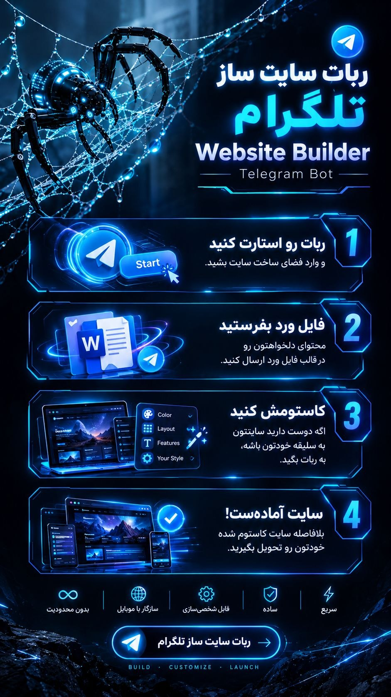
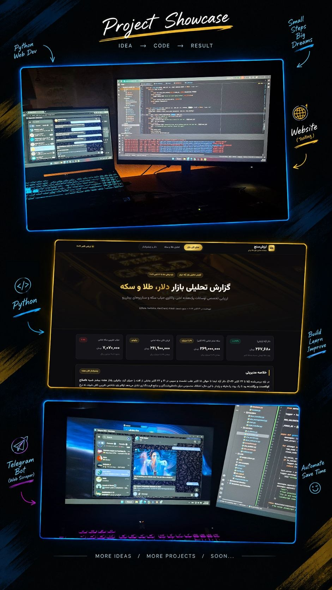
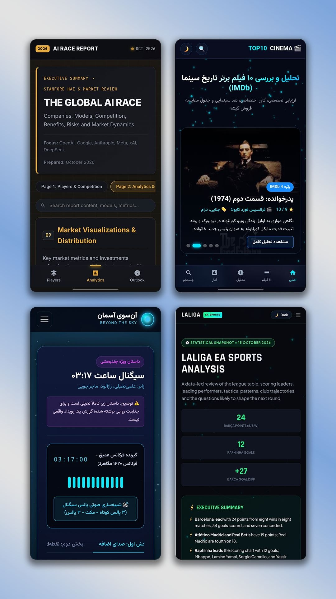

# ربات سایت‌ساز تلگرام | GassLight WebMaker Bot

**مقاله‌ی ورد خودتون رو مستقیم از تلگرام به یه سایت آماده‌ی اشتراک‌گذاری تبدیل کنید.**
بدون کدنویسی، بدون هاست، بدون نیاز به دانش طراحی.

🌐 [English](README.md) | **فارسی**

[**🚀 ورود به ربات: @GassLight_WebMaker_Bot**](https://t.me/GassLight_WebMaker_Bot)

---

## 📑 فهرست مطالب

- [ربات چه کاری انجام می‌ده؟](#-ربات-چه-کاری-انجام-میده)
- [نمونه‌ها و تصاویر](#-نمونهها-و-تصاویر)
- [نمونه‌های زنده](#-نمونههای-زنده)
- [شروع سریع](#-شروع-سریع)
- [مرحله‌ی ۱: آماده‌سازی مقاله](#-مرحلهی-۱-آمادهسازی-مقاله)
- [مرحله‌ی ۲: توضیح ظاهر سایت](#-مرحلهی-۲-توضیح-ظاهر-سایت)
- [مرحله‌ی ۳: صبر برای ساخت سایت](#-مرحلهی-۳-صبر-برای-ساخت-سایت)
- [مرحله‌ی ۴: دریافت لینک](#-مرحلهی-۴-دریافت-لینک)
- [مدیریت سایت‌ها](#-مدیریت-سایتها)
- [اعتبار و قیمت](#-اعتبار-و-قیمت)
- [سوالات متداول](#-سوالات-متداول)
- [استفاده‌ی منصفانه](#-استفادهی-منصفانه)
- [پشتیبانی](#-پشتیبانی)

---

## ✨ ربات چه کاری انجام می‌ده؟

شما مقاله‌تون رو در قالب یه فایل ورد (`.docx`) برای ربات می‌فرستید، به ربات می‌گید سایتتون چه ظاهری داشته باشه، و چند لحظه بعد یه لینک زنده تحویل می‌گیرید که می‌تونید با هر کسی به اشتراک بذارید.

---

## 🖼️ نمونه‌ها و تصاویر

### راهنمای تصویری ۴ مرحله‌ای

### از ایده تا نتیجه

### سایت‌های ساخته‌شده با ربات

چهار نمونه سایت واقعی که از مقاله‌های ورد ساخته شدن: گزارش بازار هوش مصنوعی، تحلیل سینما، داستان تعاملی و تحلیل آماری فوتبال. همه‌ی اون‌ها کاملاً با موبایل سازگارن.

---

## 🔗 نمونه‌های زنده

از لینک زیر می‌تونید همه‌ی نمونه‌ها رو یک‌جا ببینید. **خودِ این صفحه هم با همین ربات ساخته شده.**

👉 **https://site-d2d61b5879adf3d0.webmaker.dpdns.org/**

---

## 🚀 شروع سریع

1. وارد [@GassLight_WebMaker_Bot](https://t.me/GassLight_WebMaker_Bot) بشید و **Start** رو بزنید.
2. مقاله‌تون رو به‌صورت فایل **`.docx`** بفرستید.
3. به چند سوال کوتاه درباره‌ی ظاهر سایت جواب بدید.
4. صبر کنید تا سایت ساخته بشه.
5. لینک رو بگیرید و تو هر مرورگری بازش کنید.

---

## 📄 مرحله‌ی ۱: آماده‌سازی مقاله

مقاله‌ی شما باید یه فایل ورد با پسوند **`.docx`** باشه.

**نکات برای بهترین نتیجه**

- بالای فایل یه **عنوان** واضح بذارید.
- برای بخش‌ها از **استایل Heading** ورد (Heading 1، Heading 2 و...) استفاده کنید. ربات از اون‌ها برای سازمان‌دهی سایت استفاده می‌کنه.
- محتوا رو به‌صورت پاراگراف‌های معمولی بنویسید.
- مطمئن بشید فایل خالی نیست و رمز نداره.
- فایل‌های قدیمی `.doc` پشتیبانی نمی‌شن. تو ورد مسیر *File → Save As → Word Document (.docx)* رو برید.
- فایل رو تو تلگرام به‌صورت **فایل/Document** بفرستید، نه عکس و نه متن کپی‌شده.

مقاله‌ها به هر زبانی پشتیبانی می‌شن، از جمله زبان‌های راست‌به‌چپ مثل فارسی.

---

## 🎨 مرحله‌ی ۲: توضیح ظاهر سایت

بعد از دریافت فایل، ربات چند سوال کوتاه ازتون می‌پرسه. هر کدوم به شکل‌گیری طراحی نهایی کمک می‌کنه:

| سوال | چی رو تعیین می‌کنه |
|---|---|
| **رنگ** | رنگ اصلی سایت |
| **سبک** | حس و حال کلی و سبک طراحی (مثلاً مینیمال، مدرن، شیک، شاد) |
| **نمودار** | اینکه اگه مقاله‌تون داده داره، نمودار هم داشته باشه یا نه |
| **چندصفحه‌ای** | اینکه سایت به چند صفحه تقسیم بشه یا تک‌صفحه‌ای باشه |
| **توضیحات دیگه** | هر چیز دیگه‌ای که می‌خواید، با کلمات خودتون |

### ⏭️ رد کردن سوال‌ها

زیر هر سوال یه دکمه‌ی **Skip** هست. اگه برای یه سوال نظر خاصی ندارید، بزنیدش و ربات خودش یه گزینه‌ی مناسب انتخاب می‌کنه.

### 💡 نکات برای نتیجه‌ی بهتر

- تو بخش *توضیحات دیگه* دقیق باشید. مثلاً: *«پس‌زمینه‌ی تیره، متن بزرگ و خوانا، منوی ثابت بالای صفحه و فوتر با اسم من.»*
- **حس و حال** مورد نظرتون رو بگید (آروم، حرفه‌ای، جسور، دوستانه).
- اگه مقاله‌تون عدد و آمار داره بگید، تا ربات بهتر نمایششون بده.

---

## ⏳ مرحله‌ی ۳: صبر برای ساخت سایت

بعد از جواب دادن به آخرین سوال، ربات سایت رو می‌سازه و منتشر می‌کنه. معمولاً کمی طول می‌کشه. تو این مدت پیام اضافه نفرستید.

اگه مشکلی پیش بیاد، ربات بهتون خبر می‌ده و می‌تونید دوباره فایل رو بفرستید و تلاش کنید.

---

## 🔗 مرحله‌ی ۴: دریافت لینک

وقتی آماده شد، ربات لینک سایت زنده‌تون رو می‌فرسته. سایت شما:

- ✅ همون لحظه آنلاینه
- ✅ روی موبایل و دسکتاپ قابل مشاهده‌ست
- ✅ قابل اشتراک‌گذاریه، فقط لینک رو بفرستید

> 🔒 هر سایت یه آدرس تصادفی و غیرقابل‌حدس مخصوص خودش داره.

---

## 📂 مدیریت سایت‌ها

بخش **My Sites** رو تو ربات باز کنید تا همه‌ی سایت‌هایی که ساختید رو ببینید.

- هر سایت به‌صورت یه **دکمه** با اسم خودش نمایش داده می‌شه.
- روی سایت بزنید تا **لینکش** دوباره فرستاده بشه.
- زیر لینک یه دکمه‌ی **Delete** هست.

### 🗑️ حذف سایت

با زدن **Delete** سایت برای همیشه حذف می‌شه. لینک از کار می‌افته و **این کار قابل بازگشت نیست**. اگه ممکنه دوباره بهش نیاز داشته باشید، فایل ورد اصلی رو نگه دارید.

---

## 💳 اعتبار و قیمت

ربات با یه سیستم اعتبار ساده کار می‌کنه.

| | |
|---|---|
| 🎁 **کاربر جدید** | به‌طور خودکار **۲ اعتبار رایگان** می‌گیره |
| 🏗️ **هزینه** | ساخت هر سایت **۱ اعتبار** هزینه داره |
| 🛒 **وقتی اعتبار تموم شد** | برای ادامه‌ی ساخت سایت باید اعتبار بخرید |

### نحوه‌ی خرید

1. دستور **/buy** رو بفرستید.
2. ربات اطلاعات پرداخت و قیمت رو نشون می‌ده:
   - 🇮🇷 **داخل ایران:** ۵۰۰,۰۰۰ تومان (کارت بانکی)
   - 🌍 **خارج از ایران:** ۲ تتر USDT (کیف پول ارز دیجیتال)
3. پرداخت رو انجام بدید.
4. **عکس رسید پرداخت** رو برای ربات بفرستید.
5. رسید به‌صورت دستی بررسی می‌شه و ربات بهتون می‌گه تو حال بررسیه.
6. بعد از تأیید، **۵۰ اعتبار** دریافت می‌کنید.

### ⚠️ خوبه بدونید

- اعتبار خریداری‌شده **۱ ماه** اعتبار داره. بعد از اتمام ماه، اشتراک منقضی می‌شه و ربات بهتون اطلاع می‌ده.
- تو مرحله‌ی پرداخت فقط **عکس واضح** رسید پذیرفته می‌شه.
- بررسی دستیه، پس ممکنه تأیید کمی زمان ببره.

---

## ❓ سوالات متداول

**می‌تونم فایل `.doc`، `.pdf` یا متن ساده بفرستم؟**
نه. فقط فایل‌های ورد با فرمت `.docx` پشتیبانی می‌شن.

**بعد از ساخت، می‌تونم سایت رو ویرایش کنم؟**
ویرایش سایت موجود هنوز در دسترس نیست. فعلاً مقاله یا جواب‌های سبکتون رو اصلاح کنید و یه سایت جدید بسازید.

**نتیجه اونی نیست که تو ذهنم بود، چیکار کنم؟**
دوباره با جواب‌های دقیق‌تر بسازید، به‌خصوص تو مرحله‌ی *توضیحات دیگه*. هرچی دقیق‌تر باشید، نتیجه به ایده‌تون نزدیک‌تره.

**اعتبارم تموم شده، حالا چی؟**
با **/buy** اعتبار بخرید.

**پرداختم هنوز تأیید نشده.**
رسیدها دستی بررسی می‌شن. کمی صبر کنید. نیازی به ارسال دوباره‌ی رسید نیست.

**با حذف سایت، اعتبارم برمی‌گرده؟**
نه. اعتبار موقع ساخت سایت مصرف می‌شه.

---

## 📌 استفاده‌ی منصفانه

لطفاً فقط محتوایی رو منتشر کنید که حق انتشارش رو دارید. سایت‌های حاوی محتوای مخرب، گمراه‌کننده، فیشینگ یا غیرقانونی مجاز نیستن و ممکنه حذف بشن.

---

## 💬 پشتیبانی

مشکل یا پیشنهادی دارید؟ از طریق تلگرام با مالک ربات در ارتباط باشید.

🌐 [English](README.md) | **فارسی**

