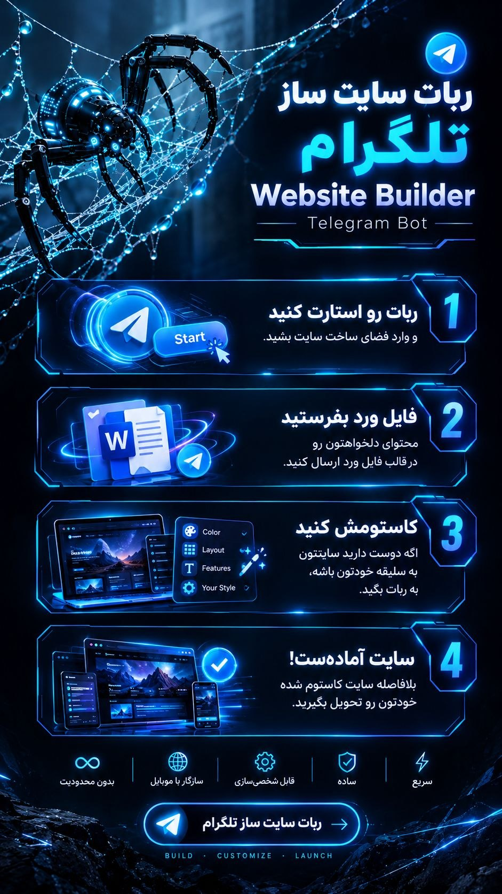
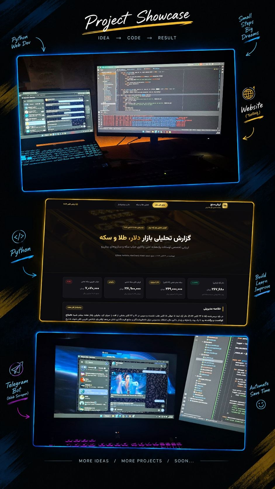
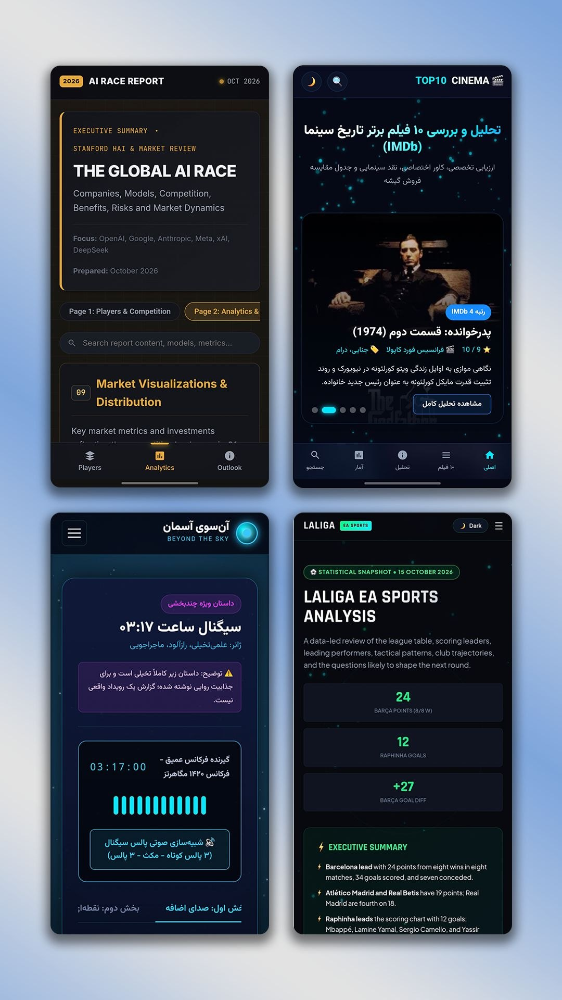

# GassLight WebMaker Bot

**Turn your Word article into a ready-to-share website, right from Telegram.**
No coding, no hosting, no design skills needed.

🌐 **English** | [فارسی](README.fa.md)

[**🚀 Open the bot: @GassLight_WebMaker_Bot**](https://t.me/GassLight_WebMaker_Bot)

---

## 📑 Table of contents

- [What it does](#-what-it-does)
- [See it in action](#-see-it-in-action)
- [Live examples](#-live-examples)
- [Quick start](#-quick-start)
- [Step 1: Prepare your article](#-step-1-prepare-your-article)
- [Step 2: Describe your site](#-step-2-describe-your-site)
- [Step 3: Wait for your site](#-step-3-wait-for-your-site)
- [Step 4: Get your link](#-step-4-get-your-link)
- [Managing your sites](#-managing-your-sites)
- [Credits & pricing](#-credits--pricing)
- [FAQ](#-faq)
- [Fair use](#-fair-use)
- [Support](#-support)

---

## ✨ What it does

You send the bot an article as a Word file (`.docx`), tell it how you want your site to look, and a few moments later you get a live link you can open and share with anyone.

---

## 🖼️ See it in action

### The 4-step visual guide (Persian)

### From idea to result

### Sites built with the bot

Real sites generated from Word articles: an AI market report, a cinema analysis, an interactive story, and a football statistics review. All of them are fully responsive on mobile.

---

## 🔗 Live examples

Open the quick-access page below to browse all the sample sites in one place. **This page itself was also built with the bot.**

👉 **https://site-d2d61b5879adf3d0.webmaker.dpdns.org/**

---

## 🚀 Quick start

1. Open [@GassLight_WebMaker_Bot](https://t.me/GassLight_WebMaker_Bot) and press **Start**.
2. Send your article as a **`.docx`** file.
3. Answer a few short questions about the look of your site.
4. Wait while the site is being built.
5. Receive your link and open it in any browser.

---

## 📄 Step 1: Prepare your article

Your article must be a Word file with the **`.docx`** extension.

**Tips for the best result**

- Use a clear **title** at the top.
- Use **Heading styles** in Word (Heading 1, Heading 2, ...) for sections. The bot uses them to organize your site.
- Write your content as normal paragraphs.
- Make sure the file is not empty and not password-protected.
- Older `.doc` files are not supported. In Word choose *File → Save As → Word Document (.docx)*.
- Send the file as a **document/file** in Telegram, not as a photo or pasted text.

Articles in any language are supported, including right-to-left languages such as Persian.

---

## 🎨 Step 2: Describe your site

After your file is received, the bot asks you a short series of questions. Each one helps shape the final design:

| Question | What it controls |
|---|---|
| **Color** | The main color theme of your site |
| **Style** | The overall mood and design style (for example minimal, modern, elegant, playful) |
| **Chart** | Whether charts should be included, if your article contains data |
| **Multi-page** | Whether the site should be split into multiple pages or stay as a single page |
| **Other details** | Anything else you want, in your own words |

### ⏭️ Skipping questions

Every question has a **Skip** button. If you don't care about a question, press it and the bot will choose a sensible default for you.

### 💡 Tips for better results

- Be specific in *Other details*. For example: *"Dark background, large readable text, a sticky navigation menu, and a footer with my name."*
- Mention the **mood** you want (calm, professional, bold, friendly).
- If your article has numbers or statistics, say so, so the bot can present them well.

---

## ⏳ Step 3: Wait for your site

Once you answer the last question, the bot builds and publishes your site. This usually takes a short while. Please don't send extra messages during this time.

If something goes wrong, the bot tells you. You can simply send your file again and retry.

---

## 🔗 Step 4: Get your link

When it's ready, the bot sends you a link to your live site. Your site is:

- ✅ Online immediately
- ✅ Viewable on phone and desktop
- ✅ Shareable with anyone, just send them the link

> 🔒 Each site gets its own random, hard-to-guess address.

---

## 📂 Managing your sites

Open **My Sites** in the bot to see everything you've created.

- Each site appears as a **button** labeled with its name.
- Tap a site to receive its **link** again.
- Under the link you'll find a **Delete** button.

### 🗑️ Deleting a site

Pressing **Delete** removes the site permanently. The link stops working and **this cannot be undone**. Make sure you've saved your original Word file if you may need it again.

---

## 💳 Credits & pricing

The bot works with a simple credit system.

| | |
|---|---|
| 🎁 **New users** | Get **2 free credits** automatically |
| 🏗️ **Cost** | Creating one site costs **1 credit** |
| 🛒 **When credits run out** | You need to purchase more to keep creating sites |

### How to buy

1. Send the **/buy** command.
2. The bot shows the payment details and the price:
   - 🇮🇷 **Inside Iran:** 500,000 Toman (bank card)
   - 🌍 **Outside Iran:** 2 USDT (crypto wallet)
3. Make the payment.
4. Send a **photo of your payment receipt** to the bot.
5. Your receipt is reviewed manually, and you'll be told it's under review.
6. After approval, you receive **50 credits**.

### ⚠️ Good to know

- Purchased credits are valid for **1 month**. When the month ends, your subscription expires and the bot notifies you.
- Only a **clear photo** of the receipt is accepted at the payment step.
- Review is manual, so approval may take some time.

---

## ❓ FAQ

**Can I send a `.doc`, `.pdf` or plain text?**
No. Only Word files in `.docx` format are supported.

**Can I edit the website after it's created?**
Editing an existing site is not available yet. For now, adjust your article or your style answers and create a new one.

**The result isn't what I imagined. What can I do?**
Create it again with more detailed answers, especially in the *Other details* step. The more specific you are, the closer the result will be to your idea.

**I ran out of credits. What now?**
Use **/buy** to purchase more.

**My payment hasn't been confirmed yet.**
Receipts are checked manually. Please wait a little. There's no need to send the receipt again.

**Does deleting a site refund my credit?**
No. Credits are spent when a site is created.

---

## 📌 Fair use

Please only publish content you have the right to share. Sites containing harmful, misleading, phishing, or illegal content are not allowed and may be removed.

---

## 💬 Support

Having a problem or a suggestion? Contact the bot owner through Telegram.

🌐 **English** | [فارسی](README.fa.md)

